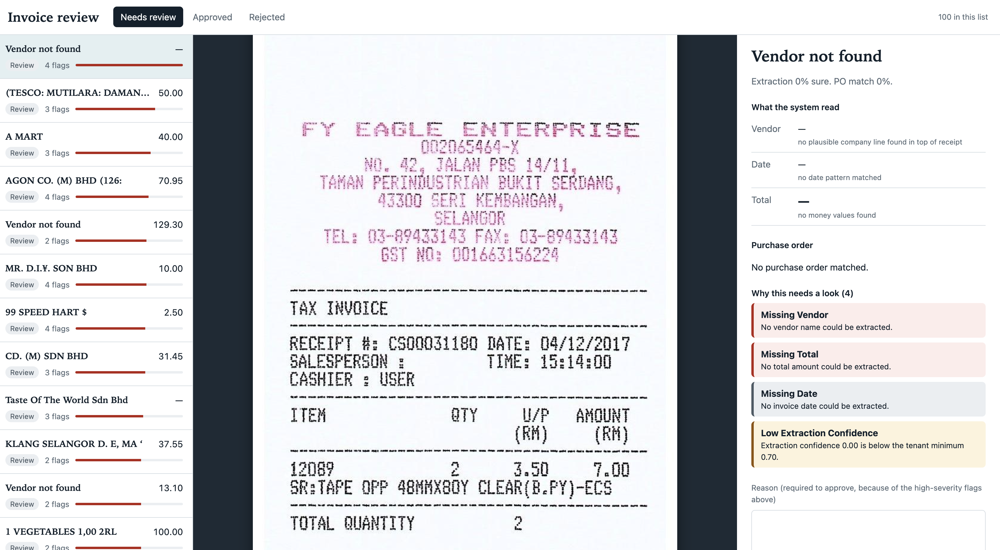

# AP Last-Mile Pipeline

An integration layer that makes AI safe to use inside real accounts payable workflows. It extracts invoice data with OCR, scores its own confidence, routes uncertain items to a human reviewer, writes only approved results to a mock ERP, and reconciles payments against bank statements, with an audit log of every decision.

**Why it exists:**
manual invoice processing costs an estimated $10-15 per invoice and ~17 days of cycle time. The model reading the invoice is the easy part. The hard part is the last mile: governance, legacy-system write-back, and per-customer configuration.

Built as a portfolio project demonstrating Forward Deployed Engineering skills: bridging demo-grade AI with the messy, governed reality of enterprise workflows.

See [`docs/MVP_SPEC.md`](docs/MVP_SPEC.md) for the full spec: user stories, data model, architecture, milestones, and metrics.

## Stack

- **Frontend:** Next.js (Vercel)
- **Backend:** FastAPI (Render)
- **Database:** Postgres (Neon / Supabase)
- **Storage:** Supabase Storage
- **Extraction:** Tesseract OCR + rule-based parsing (optional LLM path, flagged)

Entirely free-tier deployable — no paid infra required.

## Project structure

```
backend/
  app/
    routes/      # FastAPI route handlers
    services/     # extraction, matching, audit logic
    models/       # SQLAlchemy models / Pydantic schemas
  migrations/     # DB migrations
  scripts/        # seed data, dataset download helpers
frontend/
  app/            # Next.js app router pages
  components/     # shared UI components
docs/
  MVP_SPEC.md     # full MVP specification
```

## Status

In development — see `docs/MVP_SPEC.md` §8 for the milestone roadmap.

## Local setup

```bash
# 1. Start Postgres locally
docker compose up -d

# 2. Set up the Python backend
cd backend
python -m venv .venv && source .venv/bin/activate   # Windows: .venv\Scripts\activate
pip install -r requirements.txt
cp .env.example .env

# 3. Create tables
python scripts/init_db.py

# 4. Seed demo tenant, vendors, POs, synthetic bank transactions
python scripts/seed.py

# 5. (Optional) download real sample invoice receipts for extraction testing
python scripts/download_sroie.py --n 25

# 6. Run the API
uvicorn app.main:app --reload
# -> http://localhost:8000/health
```

## Roadmap and Status

The build is split into six milestones. Each one ends with something you can run and demo.

| #   | Milestone                                        | Status                              |
| --- | ------------------------------------------------ | ----------------------------------- |
| 1   | Repo, schema, seed data, real receipt dataset    | Done                                |
| 2   | Invoice ingestion and extraction with confidence | Done                                |
| 3   | PO matching, review queue, audit log             | Backend done, review UI in progress |
| 4   | Mock ERP write-back and expected payments        | Planned                             |
| 5   | Bank reconciliation                              | Planned                             |
| 6   | Metrics dashboard and cloud deployment           | Planned                             |

### Milestone 1: Foundation

**Objective:** a reproducible local environment with realistic data to build against.

- Multi-tenant Postgres schema: tenants, users, vendors, purchase orders, invoices, review decisions, expected payments, bank transactions, reconciliation matches, audit log.
- Seed script generating a demo tenant with vendors, POs and noisy synthetic bank transactions (fee deductions, date drift, truncated references).
- Downloader for the SROIE dataset (real scanned receipts with ground-truth company, date, address and total).
- FastAPI skeleton with a `/health` endpoint, Docker Compose for local Postgres.

**Done when:** `docker compose up`, `init_db.py` and `seed.py` produce a queryable database, and real receipts with ground truth are on disk.

### Milestone 2: Extraction with confidence

**Objective:** turn a receipt image into structured fields, and say how sure the system is and why.

- Tesseract OCR plus a rule-based parser for company, date and total. Every field returns a value, a confidence and a plain-English reason, for example `matched keyword line: 'Total Inclusive GST: 193.00'`.
- `POST /invoices/upload` stores the invoice with its confidence and flags.
- `scripts/eval_extraction.py` scores extraction against the real SROIE ground truth.

**Results on 100 held-out receipts** (receipts that were never inspected while building the extractor; code frozen at commit `fbd4bdd` before the run):

| Field   | Accuracy |
| ------- | -------- |
| Company | 59%      |
| Date    | 69%      |
| Total   | 47%      |
| Overall | 58.3%    |

On the 100 development receipts, total accuracy reached 63% after tuning. It fell to 47% on unseen receipts, so tuning on a small set overstated real accuracy by about 16 points. The held-out numbers are the ones to trust. An earlier version of the evaluation also counted a bare "SDN BHD" as a correct company match; that is fixed.

Every receipt with extraction confidence below 0.7 had at least one wrong field, both in earlier runs (21 of 21) and on the held-out set (26 of 26), so a low score is a reliable "look at this" signal. That is precision only. Many wrong totals still come out with high confidence, which is why Milestone 3 validates against a second source instead of trusting extraction confidence alone.

See [`docs/EVALUATION.md`](docs/EVALUATION.md) for the full method and results.

**Known ceiling:** a share of the misses are receipts where the OCR text itself is garbled. No parser fixes that, so the design routes uncertain items to a human instead of chasing more regex.

**Done when:** uploading a receipt returns fields with confidences and reasons, and the row is saved in Postgres.

### Milestone 3: Matching, routing and review

**Objective:** check extracted data against the system of record, and put a human in the loop for anything doubtful.

- **Matching service:** fuzzy vendor match (tolerates partial OCR names and legal suffixes), closest open PO by amount, configurable tolerance.
- **Anomaly flags with severity and a stated reason:** `no_vendor_match`, `weak_vendor_match`, `no_po_match`, `amount_mismatch`, `duplicate_invoice`, `possible_duplicate`, `low_extraction_confidence`, `missing_vendor`, `missing_total`, `missing_date`, `future_date`, `implausible_date`.
- **Routing:** an invoice is `fast_track` only when it has no flags and both extraction and PO-match confidence are high. Everything else gets full review. Nothing auto-approves unless the tenant explicitly opts in.
- **Review API:** a risk-sorted queue, invoice detail with its audit trail, and `approve`, `edit` or `reject` decisions.
- **Governance rules:** rejections need a reason, approving over a high-severity flag needs a written override reason, a decided invoice cannot be decided again, and an edit re-runs matching on the corrected values.
- **Audit log:** every AI step and human decision is recorded with actor, before state and after state, in the same transaction as the change it describes.
- **Test suite:** 44 tests covering the matching rules, extraction regressions taken from real failures, end-to-end API flows, and the evaluation scoring.
- **Pipeline evaluation:** on 100 held-out receipts, 56 had a wrong vendor or total. Trusting extraction confidence alone would have let 18 of them skip review. The full system let 1 through, at the cost of about two extra human reviews for each additional error caught. About 88% of invoices still go to a human, so this is a safety result, not an automation-rate result.
- Still to build: a minimal Next.js review screen showing the receipt image next to the extracted fields and flags.

**Done when:** an uploaded invoice is matched and flagged, appears in the queue in risk order, can be approved, edited or rejected, and the full history is visible in its audit trail.

### Milestone 4: Mock ERP write-back

**Objective:** show the "write to a legacy system of record" step safely.

- A mock ERP service with its own storage, behind a connector interface so a real SAP or NetSuite connector can replace it without touching the pipeline.
- Approved invoices are posted to the ERP and an expected payment is created. Posting uses an idempotency key, so retries cannot create duplicates.
- Simulated failures and timeouts, with retry handling and an audit entry for every attempt.

**Done when:** approving an invoice produces a `posted` invoice and an expected-payment record, and re-posting the same invoice does not create a second one.

### Milestone 5: Bank reconciliation

**Objective:** match what the bank actually paid against what the books expected.

- Upload a messy bank statement CSV.
- Matcher using amount (tolerant of fees), date window and fuzzy reference, returning a confidence and a reason for each suggestion.
- The same review pattern as invoices: confirm or reject suggestions, and unmatched items surface for a human.
- Confirming a match updates both the bank transaction and the expected payment.

**Done when:** uploading a synthetic statement produces suggested matches with reasons, and confirming one marks the expected payment as matched.

### Milestone 6: Metrics and deployment

**Objective:** a public demo that reports measurable outcomes.

- `/metrics` aggregates: invoices processed, fast-track versus escalated rate, human override rate, average time from upload to posted, reconciliation match rate, and estimated time and cost saved against published AP benchmarks.
- Dashboard and review screens in Next.js.
- Deployment on free tiers: frontend on Vercel, backend on Render, database on Neon or Supabase.

**Done when:** the full flow runs on a public URL and the dashboard shows real numbers from a seeded run.

### Known limitations

- Invoice data is real (SROIE receipts). Purchase orders and bank data are synthetic, generated for the demo, because no public dataset of real ones exists.
- Extraction accuracy is bounded by OCR quality on poor scans.
- Cost and time savings are estimates against published industry benchmarks, not measured at a real customer.
- Authentication is simplified for the MVP. Every query is already scoped by tenant, so adding real auth changes one function.
- A Postgres status column stands in for a message queue. A production deployment would use SQS or Redis workers.
